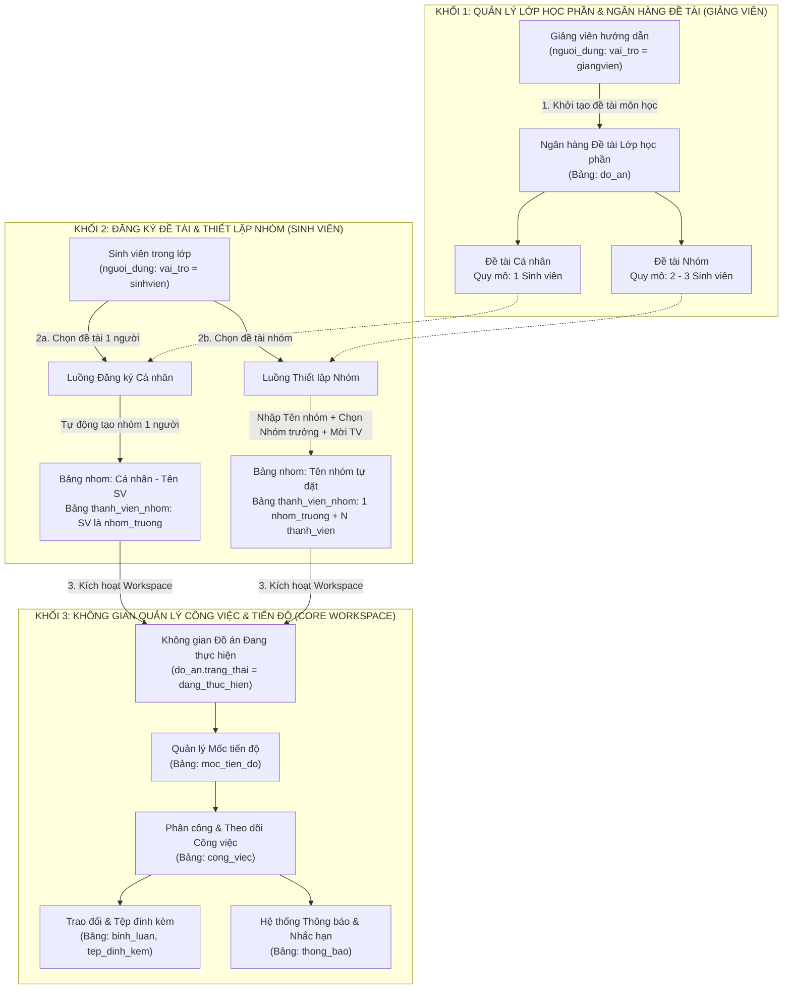
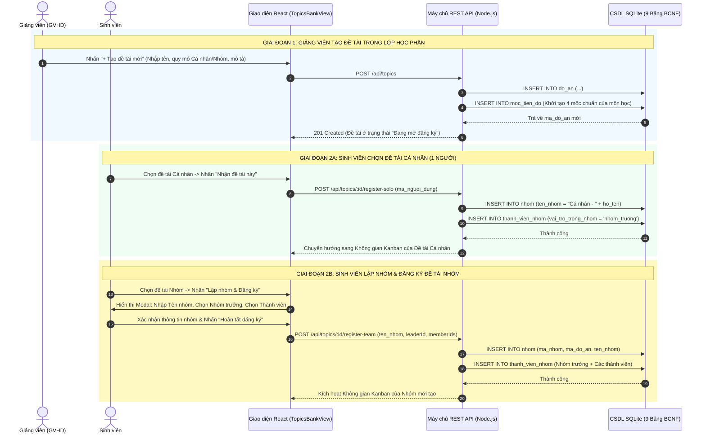

# Lược đồ Thông tin Nghiệp vụ & Kịch bản Bảo vệ Đồ án trước Hội đồng

> **Mục đích tài liệu:** Tài liệu này được biên soạn chuẩn học thuật nhằm cung cấp các **Lược đồ thông tin (Information Diagrams)**, **Bảng ánh xạ dữ liệu BCNF** để nhóm đưa trực tiếp vào báo cáo thuyết minh Word (`dacs.doc`), đồng thời lưu trữ **Kịch bản trình diễn & Chiến lược trả lời phản biện trước Hội đồng**.

---

## Phần 1: Hệ thống Lược đồ Thông tin (Dùng để đưa vào Báo cáo)

### 1.1. Lược đồ Luồng Thông tin Tổng thể (Information Flow Diagram - IFD)

Sơ đồ dưới đây mô tả luồng thông tin xuyên suốt từ khi Giảng viên khởi tạo đề tài trong lớp học phần cho đến khi Sinh viên nhận đề tài (Cá nhân hoặc Nhóm) và đi vào không gian quản lý tiến độ:



---

### 1.2. Lược đồ Thông tin Ánh xạ Thực thể vào 9 Bảng CSDL Chuẩn BCNF

Để bảo toàn tuyệt đối tập 20 thuộc tính $Q = \{A, B, C, \dots, W\}$, tập 8 phụ thuộc hàm $F = \{f_1 \dots f_8\}$ và bảng chứng minh **Tableau $20 \times 8$**, hệ thống ánh xạ thông tin lớp học, ngân hàng đề tài và mô hình nhóm (1 người / nhiều người) trực tiếp vào các quan hệ đã chuẩn hóa BCNF như sau:

```mermaid
erDiagram
    NGUOI_DUNG ||--o{ DO_AN : "ma_giang_vien (K -> H)"
    DO_AN ||--o| NHOM : "ma_do_an UNIQUE (H <-> M)"
    NHOM ||--|{ THANH_VIEN_NHOM : "ma_nhom (M -> P, R)"
    NGUOI_DUNG ||--o{ THANH_VIEN_NHOM : "ma_nguoi_dung (P -> M, R)"
    DO_AN ||--o{ MOC_TIEN_DO : "ma_do_an (U -> H)"
    MOC_TIEN_DO ||--o{ CONG_VIEC : "ma_moc (A -> U)"
    NGUOI_DUNG ||--o{ CONG_VIEC : "ma_nguoi_thuc_hien (A -> P)"
    CONG_VIEC ||--o{ BINH_LUAN : "ma_cong_viec"
    CONG_VIEC ||--o{ TEP_DINH_KEM : "ma_cong_viec"
    NGUOI_DUNG ||--o{ THONG_BAO : "ma_nguoi_dung"

    DO_AN {
        string ma_do_an PK "H: Mã đồ án"
        string ten_do_an "I: Tên đề tài đồ án"
        string loai_do_an "J: mon_hoc | co_so | chuyen_nganh"
        string ten_mon_hoc "Tên môn & Mã lớp học phần"
        string noi_dung_muc_tieu "Mô tả yêu cầu & Quy mô (Cá nhân/Nhóm)"
        float tien_do_tong "% Tiến độ tổng thể (0-100)"
        string trang_thai "dang_thuc_hien | hoan_thanh | tam_dung"
        string ma_giang_vien FK "K: Giảng viên ra đề tài"
    }

    NHOM {
        string ma_nhom PK "M: Mã nhóm"
        string ma_do_an FK_UNIQUE "H: Khóa ngoại duy nhất (1-1)"
        string ten_nhom "N: Tên nhóm / Cá nhân - Tên SV"
    }

    THANH_VIEN_NHOM {
        string ma_thanh_vien_nhom PK "Khóa định danh dòng"
        string ma_nhom FK "M: Mã nhóm"
        string ma_nguoi_dung FK "P: Mã sinh viên"
        string vai_tro_trong_nhom "R: nhom_truong | thanh_vien"
    }
```

#### Bảng giải trình ánh xạ trạng thái nghiệp vụ trên CSDL BCNF (Đưa vào Chương 3 Báo cáo):

| Trạng thái Nghiệp vụ Thực tế | Biểu diễn Dữ liệu trong Bảng `do_an` | Biểu diễn trong Bảng `nhom` | Biểu diễn trong Bảng `thanh_vien_nhom` |
| :--- | :--- | :--- | :--- |
| **1. Đề tài mới trong Ngân hàng đề tài (Chưa có SV nhận)** | Đã có bản ghi trong `do_an` do Giảng viên tạo (`tien_do_tong = 0`). | **Chưa có bản ghi** (`LEFT JOIN nhom` trả về `NULL`). | **Chưa có bản ghi.** |
| **2. Đề tài Cá nhân (1 Sinh viên thực hiện)** | Bản ghi `do_an` có quy mô cá nhân, trạng thái `dang_thuc_hien`. | Có **1 bản ghi** với `ten_nhom = "Cá nhân - [Họ tên SV]"`. | Có **đúng 1 bản ghi** của SV đó với `vai_tro_trong_nhom = 'nhom_truong'`. |
| **3. Đề tài Nhóm (2 - 3 Sinh viên thực hiện)** | Bản ghi `do_an` có quy mô nhóm, trạng thái `dang_thuc_hien`. | Có **1 bản ghi** với `ten_nhom` do sinh viên tự đặt (vd: `"Nhóm 05"`). | Có **1 bản ghi** `nhom_truong` và **1..N bản ghi** `thanh_vien`. |

> **Ý nghĩa Học thuật:** Cách thiết kế này chứng minh tính ưu việt của lược đồ BCNF: mối quan hệ 1-1 giữa `do_an` và `nhom` thực chất là quan hệ `1 - (0..1)` theo thời gian (1 đề tài khi mới khởi tạo có 0 nhóm, khi đã đăng ký có đúng 1 nhóm phụ trách), hoàn toàn tương thích với phụ thuộc hàm $f_2: H \rightarrow I, J, K, M$ và $f_3: M \rightarrow N, H$ trên tập các đồ án đang triển khai.

---

### 1.3. Sơ đồ Tuần tự (Sequence Diagram): Quy trình Tạo Đề tài & Đăng ký Nhóm/Cá nhân



---

## Phần 2: Kịch bản Trình diễn & Chiến lược Bảo vệ trước Hội đồng

### 2.1. Kịch bản Thuyết trình Trực tiếp (4 Bước Vàng)

1. **Bước 1 — Mở đầu từ Góc nhìn Giảng viên (ThS. Bùi Phú Khuyên):**
   - **Thao tác trên màn hình:** Chọn vai trò `ThS. Bùi Phú Khuyên (GVHD)` trên thanh đỉnh $\rightarrow$ Mở tab **"Ngân hàng Đề tài & Lớp học"**.
   - **Lời dẫn thuyết trình:**  
     *"Kính thưa Hội đồng, quy trình quản lý đồ án môn học thực tế luôn bắt đầu từ Giảng viên phụ trách lớp học phần. Tại đây, Thầy/Cô có thể bao quát toàn bộ các đề tài trong lớp, biết rõ đề tài nào đã có nhóm nhận, đề tài nào còn trống. Em xin thao tác tạo mới 1 đề tài từ giao diện của Giảng viên, cho phép cấu hình quy mô là đề tài cá nhân (1 người) hoặc đề tài nhóm (2-3 người)."*

2. **Bước 2 — Sinh viên Nhận Đề tài Cá nhân hoặc Lập Nhóm:**
   - **Thao tác trên màn hình:** Chuyển vai trò sang Sinh viên $\rightarrow$ Tại tab **"Ngân hàng Đề tài & Lớp học"**:
     - Thử bấm vào 1 đề tài cá nhân $\rightarrow$ Nhận đề tài ngay lập tức.
     - Hoặc bấm vào 1 đề tài nhóm $\rightarrow$ Mở Modal **"Thiết lập Nhóm Đồ án"**: Đặt tên nhóm, chỉ định ai là Nhóm trưởng, tích chọn bạn cùng lớp và bấm Đăng ký.
   - **Lời dẫn thuyết trình:**  
     *"Đối với sinh viên, hệ thống giải quyết linh hoạt cả 2 hình thức của đồ án môn học: Nếu là đề tài 1 người, sinh viên chỉ cần 1 thao tác để nhận đề tài về cho mình. Nếu là đề tài nhóm, sinh viên thực hiện lập nhóm, tự đặt tên nhóm và phân công rõ ai là Nhóm trưởng ngay từ bước đăng ký."*

3. **Bước 3 — Chuyển đổi Không gian Làm việc (Workspace Switcher) & Thực thi Kanban:**
   - **Thao tác trên màn hình:** Sử dụng bộ chuyển đổi Đồ án/Nhóm ở góc trên Sidebar để chuyển về **Nhóm Đồ án Môn học 05** (đang có dữ liệu 65% tiến độ phong phú) $\rightarrow$ Mở bảng Kanban, kéo thanh trượt tự chấm tiến độ, xem linh vật Chibi tương tác và khóa tiến độ.
   - **Lời dẫn thuyết trình:**  
     *"Sau khi đề tài được đăng ký, mỗi nhóm sẽ có một không gian làm việc (Workspace) độc lập. Giảng viên có thể dùng thanh chuyển đổi nhóm để kiểm tra bất kỳ nhóm nào trong lớp, giao mốc tiến độ, xem lịch trình và khóa chốt % hoàn thành."*

4. **Bước 4 — Khẳng định Giá trị Học thuật (Chốt hạ):**
   - **Lời dẫn thuyết trình:**  
     *"Điểm đặc biệt nhất trong kiến trúc của nhóm em là toàn bộ luồng nghiệp vụ đa nhóm, đa hình thức (cá nhân/nhóm) này vẫn vận hành thuần khiết trên đúng 9 bảng CSDL đã chuẩn hóa BCNF và chứng minh bảo toàn thông tin bằng bảng Tableau $20 \times 8$ trong báo cáo."*

---

### 2.2. Bộ Câu hỏi Phản biện Dự kiến & Câu trả lời Mẫu Bảo vệ Điểm A+

#### Câu hỏi 1: *"Trong báo cáo các em ghi quan hệ giữa Đồ án (`do_an`) và Nhóm (`nhom`) là 1-1. Vậy khi đề tài mới tạo chưa có ai nhận, hoặc đề tài chỉ có 1 sinh viên làm độc lập thì lưu vào bảng `nhom` như thế nào?"*
- **Trả lời mẫu:**  
  *"Dạ thưa Thầy/Cô, trong thiết kế vật lý của nhóm em, bảng `nhom` đặt khóa ngoại `ma_do_an UNIQUE REFERENCES do_an(ma_do_an)`. Nhờ vậy:*
  1. *Khi Giảng viên mới ra đề tài, bản ghi nằm ở bảng `do_an` và chưa có bản ghi bên bảng `nhom` (quan hệ $1$ đối với $0..1$). Hệ thống nhận diện đây là đề tài **Đang mở đăng ký**.*
  2. *Khi đề tài là **Đề tài cá nhân (1 người)**, hệ thống tự động khởi tạo một nhóm đơn lẻ mang tên `'Cá nhân - [Tên Sinh viên]'` và gán chính sinh viên đó làm `nhom_truong` trong bảng `thanh_vien_nhom`. Nhờ cách đồng nhất hóa này, mọi thuật toán tính tiến độ, phân quyền giao việc và khóa công việc đều hoạt động trơn tru cho cả cá nhân lẫn nhóm nhiều người mà không cần viết hai luồng xử lý tách biệt."*

#### Câu hỏi 2: *"Tại sao các em không tách thêm bảng `lop_hoc_phan` hay `dot_dang_ky` riêng?"*
- **Trả lời mẫu:**  
  *"Dạ thưa Hội đồng, theo đúng phạm vi MVP của Đồ án cơ sở đã định nghĩa tại mục 1.5, trọng tâm cốt lõi của hệ thống là **quản lý công việc và theo dõi tiến độ đồ án môn học**, không phải hệ thống quản lý đào tạo/học vụ toàn trường. Thông tin môn học và lớp học phần được lưu trữ tại thuộc tính `ten_mon_hoc` của bảng `do_an`, giúp lược đồ giữ nguyên tập 20 thuộc tính $Q$, đạt chuẩn BCNF chặt chẽ và tránh dư thừa các bảng danh mục hành chính ít biến động."*

#### Câu hỏi 3: *"Làm sao ngăn chặn việc thành viên thường tự ý sửa tiến độ sau khi Nhóm trưởng hoặc Giảng viên đã nghiệm thu?"*
- **Trả lời mẫu:**  
  *"Dạ, nhóm em thiết kế thuộc tính `trang_thai_khoa` (E) và `ma_nguoi_khoa` ngay trên bảng `cong_viec`. Khi Nhóm trưởng hoặc Giảng viên bấm **Chốt & Khóa tiến độ**, cờ `trang_thai_khoa` chuyển sang `1` (`TRUE`). Cả tầng Giao diện (khóa thanh trượt, hiện con dấu Đã Khóa) lẫn tầng Backend REST API (`PATCH /api/tasks/:id`) đều kiểm tra điều kiện này và từ chối mọi yêu cầu chỉnh sửa `%` tiến độ cho đến khi được người có thẩm quyền mở khóa."*
